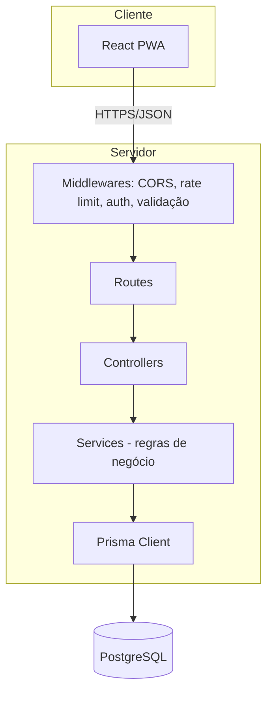
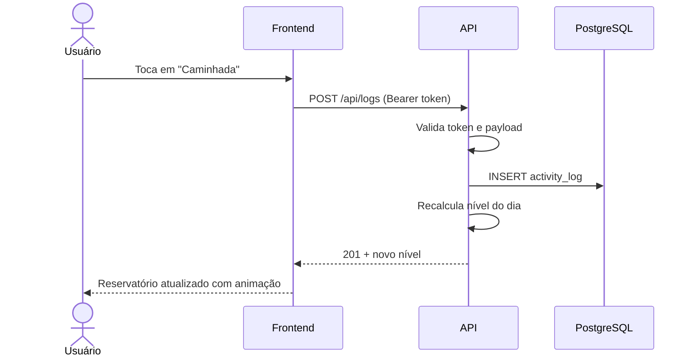

# Documentação do Projeto: Reservatório de Dopamina

## 1. Introdução

O **Reservatório de Dopamina** é um aplicativo web progressivo (PWA) de autorregulação de hábitos. Ele usa a metáfora de um reservatório que se enche com atividades saudáveis ("recargas") e se esvazia com atividades de recompensa rápida e excessiva ("drenos"), permitindo que o usuário enxergue, de forma simples e visual, o efeito de suas escolhas diárias.

> **Observação importante:** o nível exibido é uma representação lúdica baseada nos hábitos informados pelo usuário. Não é uma medição biológica nem oferece diagnóstico ou tratamento.

---

## 2. Objetivo

### 2.1 Objetivo geral
Oferecer uma ferramenta simples para que o usuário tome consciência do equilíbrio entre hábitos que fortalecem e hábitos que consomem sua energia, motivação e foco.

### 2.2 Objetivos específicos
- Permitir o registro de atividades em poucos segundos.
- Traduzir os registros em um indicador visual (nível do reservatório de 0 a 100).
- Apoiar a criação de metas diárias realistas.
- Exibir histórico e tendências semanais para apoiar a reflexão.
- Manter uma abordagem **não punitiva e motivacional**.

---

## 3. Problema a ser resolvido

Atividades de recompensa imediata (redes sociais, jogos, vídeos curtos, alimentos ultraprocessados) são projetadas para consumir atenção. O usuário geralmente:

1. não percebe quanto tempo e energia gasta nelas;
2. não tem uma visão de equilíbrio entre o que o energiza e o que o esgota;
3. encontra apps de hábitos complexos, culpabilizantes ou focados em apenas uma categoria (só exercício, só sono, só tempo de tela).

**Solução proposta:** um app unificado, leve e visual, que mostra o saldo diário entre recargas e drenos e incentiva pequenas melhorias progressivas.

---

## 4. Escopo

### 4.1 Dentro do escopo (versão 1.0)
- Cadastro, autenticação e gerenciamento básico de perfil
- Catálogo de atividades padrão e personalizadas
- Registro de atividades com duração e observação opcionais
- Cálculo e exibição do nível do reservatório diário
- Histórico diário/semanal com gráficos
- Metas diárias e sequência (streak) de dias equilibrados
- Resumo semanal (insights simples baseados em regras)
- Funcionamento como PWA (instalável, com cache básico offline)

### 4.2 Fora do escopo (versão 1.0)
- Diagnóstico, aconselhamento médico ou psicológico
- Integração com wearables ou monitoramento automático de tempo de tela
- Recursos sociais (ranking, amigos, compartilhamento)
- Aplicativos nativos iOS/Android (apenas PWA)
- Monetização, assinaturas ou anúncios
- Inteligência artificial/recomendações personalizadas (possível evolução futura)

### 4.3 Público-alvo
Jovens e adultos que desejam melhorar foco, rotina e uso de tecnologia, sem necessidade de conhecimento técnico.

### 4.4 Premissas e restrições
- O usuário registra as atividades manualmente e de forma honesta.
- Os pontos de cada atividade são valores de referência configuráveis, não científicos.
- Dados pessoais devem ser tratados conforme a **LGPD**.

---

## 5. Requisitos funcionais

| ID | Requisito | Prioridade |
|----|-----------|:----------:|
| RF01 | O sistema deve permitir cadastro de usuário com nome, e-mail e senha. | Alta |
| RF02 | O sistema deve autenticar usuários e manter sessão com tokens (access/refresh). | Alta |
| RF03 | O sistema deve disponibilizar um catálogo de atividades padrão classificadas como **recarga** ou **dreno**. | Alta |
| RF04 | O usuário deve poder criar, editar e excluir atividades personalizadas, definindo nome, tipo, pontos e ícone. | Média |
| RF05 | O usuário deve poder registrar uma atividade com data/hora, duração e observação opcionais. | Alta |
| RF06 | O usuário deve poder excluir ou corrigir um registro feito. | Média |
| RF07 | O sistema deve calcular o nível do reservatório diário (0–100) a partir dos registros do dia. | Alta |
| RF08 | O sistema deve exibir o nível em um indicador visual (reservatório) na tela inicial. | Alta |
| RF09 | O sistema deve exibir histórico de níveis por dia, semana e mês em gráficos. | Média |
| RF10 | O usuário deve poder definir metas diárias (número de recargas, minutos máximos de dreno, nível mínimo). | Média |
| RF11 | O sistema deve calcular e exibir a sequência de dias em que as metas foram atingidas. | Baixa |
| RF12 | O sistema deve gerar um resumo semanal com principais recargas, principais drenos e comparação com a semana anterior. | Baixa |
| RF13 | O usuário deve poder exportar seus dados (JSON/CSV) e excluir sua conta. | Média |

### Regra de cálculo (RF07)

```
nivel_inicial = 50
nivel_dia     = clamp(0, 100, nivel_inicial + Σ pontos dos registros do dia)

pontos do registro = pontos do tipo de atividade × fator de duração
fator de duração   = 1 (sem duração informada) ou min(duração / 30, 3)
```

Faixas de status: **0–29** Baixo · **30–59** Moderado · **60–100** Saudável.

---

## 6. Requisitos não funcionais

| ID | Categoria | Requisito |
|----|-----------|-----------|
| RNF01 | Desempenho | As rotas principais da API devem responder em até 500 ms para 95% das requisições em condições normais. |
| RNF02 | Desempenho | O carregamento inicial do frontend deve ocorrer em até 3 s em conexão 4G. |
| RNF03 | Usabilidade | Registrar uma atividade deve exigir no máximo 2 toques a partir da tela inicial. |
| RNF04 | Responsividade | A interface deve funcionar de 360 px de largura (celular) até desktop. |
| RNF05 | Acessibilidade | Seguir boas práticas WCAG 2.1 AA (contraste, navegação por teclado, rótulos). |
| RNF06 | Segurança | Senhas armazenadas com hash (bcrypt); comunicação via HTTPS; proteção contra SQL injection (ORM) e XSS; rate limiting nas rotas de autenticação. |
| RNF07 | Privacidade | Conformidade com a LGPD: consentimento, exportação e exclusão de dados do usuário. |
| RNF08 | Disponibilidade | Meta de 99% de disponibilidade mensal em produção. |
| RNF09 | Manutenibilidade | Código em TypeScript, com lint, formatação automática e cobertura de testes ≥ 80% nas regras de negócio. |
| RNF10 | Portabilidade | Execução reproduzível via Docker; configuração por variáveis de ambiente. |
| RNF11 | Compatibilidade | Suporte às duas últimas versões de Chrome, Firefox, Safari e Edge. |
| RNF12 | Observabilidade | Logs estruturados e endpoint `/health` para monitoramento. |

---

## 7. Tecnologias utilizadas

| Camada | Tecnologia | Justificativa |
|--------|-----------|---------------|
| Frontend | **React 18 + TypeScript + Vite** | Ecossistema maduro, tipagem estática e build rápido. |
| Estado/dados | **TanStack Query** | Cache e sincronização de dados da API. |
| Gráficos | **Recharts** | Gráficos declarativos integrados ao React. |
| PWA | **vite-plugin-pwa** | Instalação e cache offline básico. |
| Backend | **Node.js 20 + Express + TypeScript** | Simples, amplamente conhecido, mesma linguagem do frontend. |
| Validação | **Zod** | Validação tipada de entradas. |
| ORM | **Prisma** | Migrations, tipagem e produtividade. |
| Banco de dados | **PostgreSQL 16** | Relacional, robusto e adequado ao modelo de dados. |
| Autenticação | **JWT + bcrypt** | Padrão para APIs stateless. |
| Testes | **Vitest, Supertest, React Testing Library, Playwright** | Cobertura unitária, integração e E2E. |
| Infraestrutura | **Docker, Docker Compose, GitHub Actions** | Ambiente reproduzível e CI/CD. |
| Hospedagem | **Render (API/BD) e Vercel (frontend)** | Planos gratuitos e deploy simples. |

---

## 8. Arquitetura da aplicação

### 8.1 Visão geral

Arquitetura **cliente-servidor** com API REST, separada em duas aplicações (monorepo) e organizada em **camadas** no backend.



### 8.2 Responsabilidade das camadas (backend)

| Camada | Responsabilidade |
|--------|------------------|
| **Routes** | Define endpoints e associa middlewares e controllers. |
| **Controllers** | Recebem a requisição, validam dados (Zod), chamam services e devolvem a resposta HTTP. |
| **Services** | Contêm as regras de negócio (ex.: `ReservoirService.calculateLevel`). Não conhecem HTTP. |
| **Repositório/Prisma** | Acesso ao banco de dados. |
| **Middlewares** | Autenticação JWT, tratamento de erros, rate limit, logs. |

### 8.3 Organização dos componentes do frontend

| Componente/Pasta | Função |
|------------------|--------|
| `pages/Dashboard` | Tela inicial com o reservatório e botões rápidos de atividades. |
| `pages/History` | Histórico e gráficos por período. |
| `pages/Goals` | Gerenciamento de metas e sequência. |
| `pages/Settings` | Perfil, atividades personalizadas, exportação e exclusão de conta. |
| `components/ReservoirGauge` | Indicador animado do nível. |
| `components/ActivityButton` | Botão de registro rápido. |
| `components/Charts` | Gráficos de linha e barras. |
| `hooks/` | Hooks de dados (`useReservoir`, `useLogs`, `useGoals`). |
| `services/api.ts` | Cliente HTTP com interceptação de token e refresh. |

### 8.4 Fluxo principal: registrar uma atividade



### 8.5 Segurança

- Access token curto (15 min) e refresh token (7 dias).
- Senhas com bcrypt (custo ≥ 10).
- Validação de toda entrada com Zod.
- CORS restrito à origem do frontend.
- Rate limiting em `/auth/*`.
- Variáveis sensíveis apenas em ambiente (nunca no repositório).

---

## 9. Modelo de dados (resumo)

| Tabela | Campos principais |
|--------|-------------------|
| `users` | id, name, email (único), password_hash, created_at |
| `activity_types` | id, user_id (nulo = padrão), name, kind (RECHARGE/DRAIN), points, icon |
| `activity_logs` | id, user_id, activity_type_id, duration_min, note, occurred_at |
| `goals` | id, user_id, metric, target, active |

Diagrama completo e comandos de migration estão no [README](../README.md#-banco-de-dados).

---

## 10. Plano de testes e entrega

- **Testes unitários:** cálculo do reservatório, faixas de status, validações.
- **Testes de integração:** endpoints com banco de testes isolado.
- **Testes E2E:** cadastro → login → registro → visualização do nível.
- **CI:** lint + testes + build a cada Pull Request.
- **Deploy:** automático a partir da branch `main` (detalhes no [README](../README.md#-deploy)).

---

## 11. Evoluções futuras

- Lembretes e notificações push
- Integração com tempo de tela do sistema operacional
- Recomendações personalizadas de recargas
- Modo escuro e temas
- Aplicativo nativo (React Native)

---

## 12. Glossário

| Termo | Definição |
|-------|-----------|
| **Reservatório** | Indicador visual (0–100) do equilíbrio diário de hábitos. |
| **Recarga** | Atividade que aumenta o nível (ex.: exercício, sono, leitura). |
| **Dreno** | Atividade que diminui o nível (ex.: rolagem infinita, jogos compulsivos). |
| **Streak** | Quantidade de dias consecutivos com metas atingidas. |
